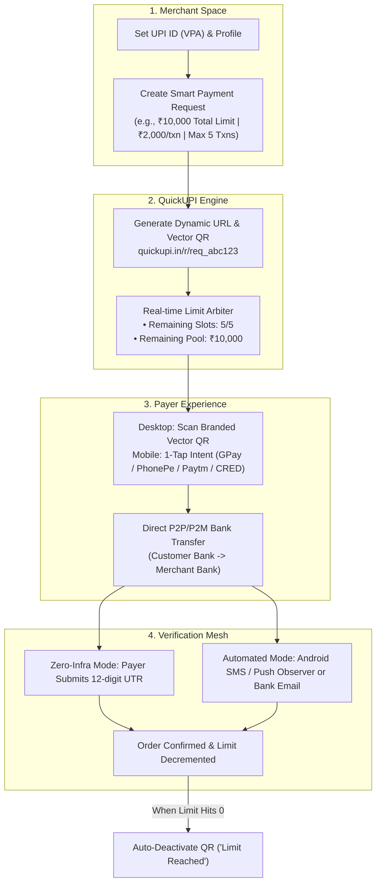

# QuickUPI — Product Blueprint & Vision Document
**A Lightweight, Zero-Fee Smart UPI Payment Collection & Orchestration Platform**

---

## 1. Executive Summary & One-Liner

> **"Don't build a payment gateway. Make existing UPI 10x smarter."**

**QuickUPI** is a sovereign payment orchestration and collection layer built directly on top of India's existing UPI infrastructure (NPCI). 

Instead of acting as a traditional payment gateway (which requires an RBI Aggregator License, holds customer funds in escrow, and takes 2%–3% per transaction), QuickUPI empowers freelancers, creators, educators, and businesses to accept payments **directly into their own bank accounts at 0% fee with instant T+0 settlement**, while providing enterprise-grade features:
- Dynamic, amount-locked QR codes & mobile deep links.
- **Reusable QRs with automated collection limits** (Amount caps & seat limits).
- Branded shareable payment pages (`quickupi.in/pay/username`).
- Real-time payment verification (UTR logging + optional automated banking observers).
- Universal 1-line checkout embed script (`quickupi.js`).

---

## 2. The Problem vs. The QuickUPI Solution

```
┌─────────────────────────────────┐       ┌─────────────────────────────────┐
│   Traditional PGs (Razorpay)    │       │     Static UPI Stickers         │
├─────────────────────────────────┤       ├─────────────────────────────────┤
│ • 2% to 3% fee + 18% GST        │       │ • Zero fee, direct to bank      │
│ • T+2 to T+3 settlement delay   │  VS   │ • NO amount locking             │
│ • Complex KYC & account freezes │       │ • NO collection limits          │
│ • ₹15-25 Cr RBI license needed  │       │ • WhatsApp screenshot nightmare │
└─────────────────────────────────┘       └─────────────────────────────────┘
                                   │
                                   ▼
          ┌─────────────────────────────────────────────────┐
          │               QuickUPI (The Sweet Spot)          │
          ├─────────────────────────────────────────────────┤
          │  0% Transaction Fees Forever                    │
          │  Direct, Instant Settlement into Bank (T+0)     │
          │  Smart Reusable QRs with Auto-Limits & Expiry   │
          │  Branded Payment Pages & Mobile Deep Links      │
          │  Automated / 1-Tap Payment Verification         │
          │  No RBI Escrow / No Middleman Holding Funds     │
          └─────────────────────────────────────────────────┘
```

---

## 3. Core Architecture & Workflow



---

## 4. Key Pillars & Feature Breakdown

### Pillar 1: Reusable QR with Automated Limits (The Hero Feature)
Traditional QRs are dumb images. A QuickUPI QR points to a smart backend session:
- **Total Collection Cap:** e.g., collect maximum ₹50,000 for a campaign. Once ₹50,000 is collected, the link automatically locks.
- **Per-Payment Amount:** Fixed (e.g., ₹2,000 fixed for an event) or flexible range (min/max).
- **Maximum Transaction Count:** e.g., only 20 early-bird tickets. When 20 payments succeed, page shows *"All slots booked!"*.
- **Expiry Timer:** Link/QR automatically expires at a specific date and time.

### Pillar 2: Omnichannel Payer Experience
- **Desktop Users:** High-contrast, scannable Vector SVG QR with live countdown timer and transaction instructions.
- **Mobile Users:** Bottom drawer with 1-tap UPI deep-links:
  - `upi://pay?pa={vpa}&pn={name}&am={amount}&cu=INR&tr={txnId}`
  - Directly opens GPay, PhonePe, Paytm, BHIM, or CRED.
- **Permanent Branded Handle:** `quickupi.in/pay/arslan` (like BuyMeACoffee / Ko-fi, but for Indian UPI).

### Pillar 3: Realistic Verification Mesh (Solving the Webhook Challenge)
QuickUPI uses a **dual-engine approach** to verify payments without an RBI gateway license:

| Mode | How it Works | Best For | Effort |
| :--- | :--- | :--- | :--- |
| **Mode A: Zero-Infra UTR Log (Default)** | Payer enters the 12-digit UPI Reference Number / UTR on the screen. Merchant sees pending transactions and approves with 1 tap (or system auto-logs). | Freelancers, coaching, consulting, B2B services. | Zero setup. 100% free. |
| **Mode B: Observer Node (Pro / Automated)** | Merchant installs a lightweight Android companion APK (or connects email) that reads bank SMS/notifications and pushes HMAC-SHA256 signed webhooks to QuickUPI. | E-commerce, automated ticket bookings, high-volume creators. | 1-time phone pairing. |
| **Mode C: Dynamic Paise Matching** | Assigns micro-variations (₹500.15, ₹500.32) to disambiguate concurrent buyers without locking them into a single-queue line. | Fast concurrent checkout. | Automated. |

### Pillar 4: Universal Checkout SDK (`quickupi.js`)
Merchants can embed QuickUPI on any website, Shopify, WooCommerce, or custom React app with just 2 lines:
```html
<script src="https://quickupi.in/quickupi.js" data-merchant-key="QUICK_PUB_123"></script>
<button data-quickupi-pay data-amount="499" data-name="Pro Course">
  Enroll Now (0% Fee UPI)
</button>
```

### Pillar 5: Merchant Command Center (Dashboard)
- **Live Metrics:** Total Collected Today, Total Volume, Active Campaigns, Expired Links.
- **Limit Utilization Meters:** Real-time visual progress bars showing money collected vs. limit ceiling.
- **Transaction Ledger:** Live ledger with UTR numbers, timestamps, payer details, and status badges (`VERIFIED`, `PENDING`, `EXPIRED`).
- **Webhook & API Key Manager:** Generate `publishable_key` and `secret_key` for custom integrations.

---

## 5. Target Audience & High-Converting Use Cases

1. **Freelancers & Consultants:** Send a dynamic ₹15,000 invoice link with payment note. Money enters bank instantly without waiting T+2 days or paying ₹450 gateway commission.
2. **Coaches, Tutors & Educators:** "First 30 students at ₹999". Reusable QR auto-closes at 30 enrollments.
3. **Event Organizers & Meetups:** Limited-seat registrations with automated cut-off.
4. **Charity & Crowdfunding:** "Help us raise ₹1,00,000 for medical aid". Real-time progress bar with zero platform cut.
5. **Indie D2C Brands:** Accept UPI payments on digital goods or merchandise without setting up expensive merchant accounts.

---

## 6. Sustainable Business Model (Since We Don't Charge Transaction Fees)

Because QuickUPI does not touch the money stream, revenue comes from **Software Subscriptions (SaaS)** and **Value-Added Services**:

```
┌─────────────────────────────────┐
│     Free Tier (Forever Free)    │
│ • Unlimited basic static QRs    │
│ • Basic payment links           │
│ • Standard UTR verification     │
│ • Up to 2 active limit QRs      │
└─────────────────────────────────┘
                │
                ▼
┌─────────────────────────────────┐
│     Pro Tier (₹499 / month)     │
│ • Unlimited Reusable Limit QRs  │
│ • Custom branding & logo on QR  │
│ • Android Observer integration  │
│ • WhatsApp receipt notification │
│ • CSV transaction export        │
└─────────────────────────────────┘
                │
                ▼
┌─────────────────────────────────┐
│   Business / Self-Hosted Pass   │
│ • Custom Domain (pay.brand.com) │
│ • Universal quickupi.js embed   │
│ • Multi-staff cashier till mode │
│ • Dedicated webhook endpoints   │
└─────────────────────────────────┘
```

---

## 7. Technology Stack Selection

- **Frontend & App Engine:** Next.js (App Router, Server Actions, API routes).
- **Styling & UI System:** Tailwind CSS + Radix UI + Lucide Icons (Dark slate, emerald green accents, high-contrast fintech typography).
- **Database & State:** Prisma ORM with SQLite (Local Dev) / PostgreSQL (Neon / Supabase for Cloud).
- **Financial Arithmetic:** Strict 64-bit integer minor units (Amounts stored in Paise: `₹2000.00` = `200000`).
- **Security & Integrity:** Server-authoritative countdown timers, HMAC-SHA256 signature verification for observers and webhooks.

---

## 8. Development Roadmap

- [x] **Milestone 1:** Concept Validation, Regulatory Analysis & Architecture Blueprint.
- [ ] **Milestone 2:** Core Database Schema (Merchant, PaymentRequest, Transaction, LimitRules).
- [ ] **Milestone 3:** Smart Payment Engine (Dynamic Vector QR Generator + Deep-Link Intent Builder).
- [ ] **Milestone 4:** Payer Public Page (`/pay/[handle]` and `/r/[requestId]`) with live limit meters & UTR submission.
- [ ] **Milestone 5:** Merchant Dashboard (Metric cards, link generator modal, live transaction table).
- [ ] **Milestone 6:** Observer & Webhook Engine (HMAC ingestion for automated bank SMS/notifications).
- [ ] **Milestone 7:** Universal `quickupi.js` Drop-in Checkout Modal.
