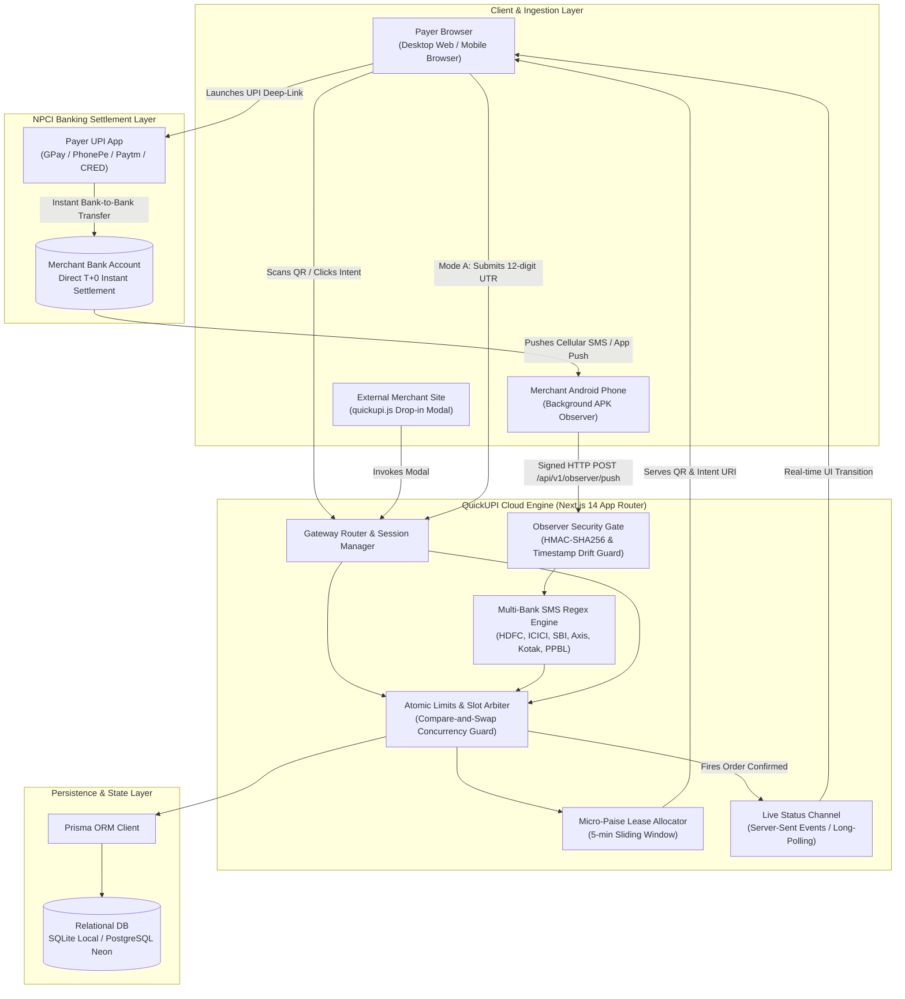
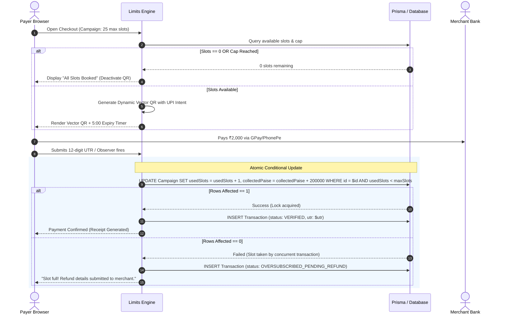
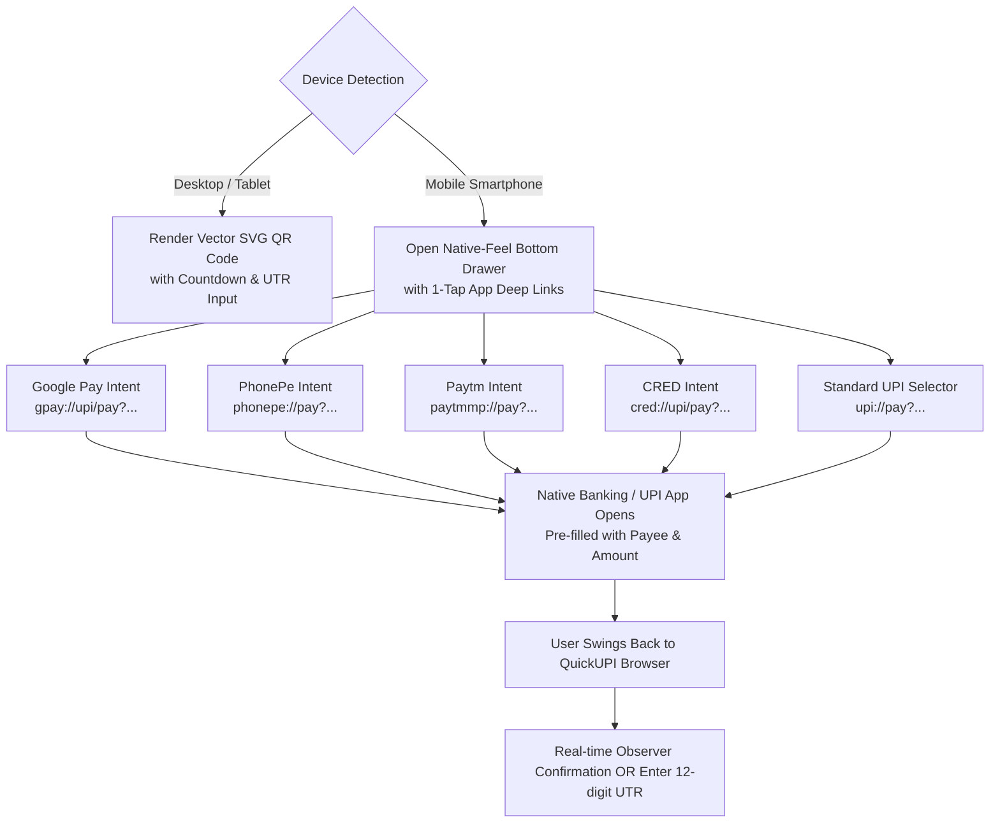

# QuickUPI System Architecture & Technical Specifications

**Document Version:** 1.0.0  
**Status:** Architectural Blueprint  
**Last Updated:** October 2026  

---

## 1. High-Level System Architecture

QuickUPI functions as a sovereign payment orchestration layer between the Payer, the Merchant, and the NPCI UPI Banking Infrastructure.



---

## 2. Dynamic Limits Engine & Atomic Arbiter

### 2.1 The Race Condition Challenge
When an event or ticket drop has limited seats (e.g., 25 slots) and multiple users scan the QR code simultaneously:
1. Payer A and Payer B both open the page when 24 slots are filled (1 slot remaining).
2. Both pay ₹2,000 via their UPI apps.
3. Without transactional arbitration, both could submit UTRs or trigger observer matches, resulting in 26 confirmed slots for a 25-slot event.

### 2.2 The QuickUPI Arbitration Protocol
QuickUPI uses a **Two-Phase Slot Lease & Confirmation Protocol**:



---

## 3. Dynamic Vector QR Generator

### 3.1 QR Specification
Unlike static bitmap QR codes (PNG/JPEG) that pixelate when scaled, QuickUPI generates **pure scalable vector SVG QR codes** conforming to ISO/IEC 18004.

* **Format:** Scalable Vector Graphics (`<svg>`)
* **Error Correction Level:** Level `M` (15% redundancy) or Level `Q` (25% redundancy) when embedding the merchant's logo in the center canvas.
* **Payload Format:** Strict NPCI UPI Deep-Link URI specification.

### 3.2 UPI Intent URI Construction
The URI string is built strictly according to the NPCI specification:
```
upi://pay?pa={vpa}&pn={name}&am={amount}&cu=INR&tr={refId}&tn={note}
```

| Parameter | Description | Example |
| :--- | :--- | :--- |
| `pa` | Payee Virtual Payment Address (VPA) | `arslan@okhdfcbank` |
| `pn` | Payee Display Name (URL Encoded) | `Arslan%20Ahmad` |
| `am` | Amount in INR formatted to 2 decimals | `1999.00` |
| `cu` | Currency (Strictly `INR`) | `INR` |
| `tr` | Merchant Transaction Reference ID | `REQ_98234821` |
| `tn` | Transaction Note displayed in payer's UPI app | `Batch%205%20Seat` |

---

## 4. Mobile Deep-Link Intent Architecture

On mobile devices, scanning a QR code is cumbersome because the QR is displayed on the device itself. QuickUPI automatically detects mobile user agents and opens an interactive **1-Tap Bottom Sheet**:



---

## 5. Security & Threat Modeling

| Threat Vector | Potential Attack | QuickUPI Mitigation Strategy |
| :--- | :--- | :--- |
| **Fake UTR Spoofing** | Malicious user submits random or guessed 12-digit numbers to get access. | 1. Rate-limiting: max 3 attempts per IP/session.<br/>2. Database UTR uniqueness index prevents reuse.<br/>3. Mode A marks status as `PENDING_MERCHANT_APPROVAL` until merchant taps verify.<br/>4. Mode B only verifies when actual bank alert matches the UTR/amount. |
| **Observer Webhook Forgery** | Attacker floods `/api/v1/observer/push` with forged bank SMS credits. | Every request requires `X-Observer-Signature` computed as `HMAC_SHA256(secretKey, body + timestamp)`. Requests with invalid signatures or > 60-second timestamp drift are rejected with HTTP 401. |
| **Micro-Paise Collisions** | Two concurrent payers paying ₹2000.12 at the same instant. | The Micro-Paise Allocator maintains an active lease pool with a 5-minute TTL. Offset `.12` is locked until payment is verified or the 5-minute lease expires. |
| **Replay Attacks** | Re-sending an old bank SMS to confirm a new order. | Every verified UTR is indexed globally. An incoming SMS with an already-consumed UTR is discarded as a duplicate. |
| **Amount Tampering** | Customer modifies the UPI intent amount from ₹2,000 to ₹1 in their UPI app. | If an observer alert or UTR reflects ₹1 instead of the campaign requirement ₹2,000, the status transitions to `AMOUNT_MISMATCH` and will NOT increment campaign slots. |

---

## 6. Directory Structure & Code Organization

```
d:/PayMe/
├── docs/                          # Architectural & Product Specifications
│   ├── PRD.md                     # Product Requirements Document
│   ├── DECISIONS.md               # Architectural Decision Records (ADRs)
│   ├── ARCHITECTURE.md            # System Architecture & Concurrency Specs
│   ├── VERIFICATION_MESH.md       # Mode A, B, C & Bank Regex Specs
│   ├── API_SPEC.md                # REST API & SDK Protocol
│   └── DATABASE_SCHEMA.md         # Prisma Schema & Model Definitions
├── prisma/                        # Database Schema & Migrations
│   ├── schema.prisma              # Data models (Merchant, Campaign, Transaction, etc.)
│   └── dev.db                     # Local SQLite database
├── public/                        # Static Assets & SDK Script
│   ├── quickupi.js                # Universal Drop-in Embed SDK
│   └── favicon.ico
├── src/
│   ├── app/                       # Next.js 14 App Router
│   │   ├── (auth)/                # Merchant Login / Register
│   │   ├── (dashboard)/           # Merchant Command Center
│   │   │   ├── dashboard/         # Metrics, Live Feeds, Limits
│   │   │   ├── campaigns/         # Campaign / Limit QR Manager
│   │   │   ├── ledger/            # Full Transaction Ledger & Manual Approval
│   │   │   ├── observer/          # Android Observer Device Pairing & Status
│   │   │   └── settings/          # API Keys, Webhooks, Profile
│   │   ├── (public)/              # Public Payer Interfaces
│   │   │   ├── pay/[handle]/      # Branded Merchant Public Page
│   │   │   └── r/[requestId]/     # Dynamic Campaign Checkout with Limit QR
│   │   └── api/                   # REST Endpoints
│   │       └── v1/
│   │           ├── observer/      # Observer Webhook Push & Heartbeat
│   │           ├── checkout/      # Session Init & Status Polling
│   │           └── verify/        # UTR Verification Endpoint
│   ├── components/                # Modular React UI Components
│   │   ├── qr/                    # Vector SVG QR Generator with Logo
│   │   ├── checkout/              # Desktop Modal & Mobile Drawer
│   │   ├── limits/                # Progress Meters & Slot Counters
│   │   └── dashboard/             # Metric Cards, Tables, Forms
│   └── lib/                       # Core Business Logic & Helpers
│       ├── arbiter.ts             # Atomic Slot & Limit Concurrency Arbiter
│       ├── hmac.ts                # Observer HMAC-SHA256 Signer & Verifier
│       ├── paise-pool.ts          # Micro-Paise Lease Allocator
│       ├── parsers/               # Multi-Bank SMS Regex Parsers
│       ├── prisma.ts              # Global Prisma Client Instance
│       └── utils.ts               # Currency formatting, UTR validators
├── package.json                   # Dependencies & Scripts
├── tailwind.config.ts             # High-Contrast Fintech Styling Tokens
├── tsconfig.json                  # TypeScript Configuration
└── README.md                      # Project Hub & Quickstart
```
