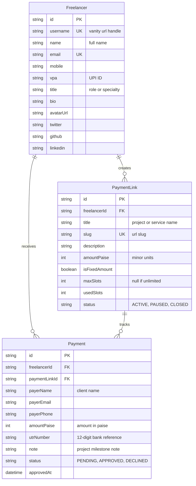

# PayMe Database Schema & Data Models

**Document Version:** 2.0.0  
**ORM:** Prisma 5.x  
**Storage Engine:** SQLite (Local Dev) / PostgreSQL (Production)  
**Last Updated:** October 2026  

---

## 1. Entity Relationship Overview

---

## 2. Model Specifications

### `Freelancer`
Represents the individual creative or technical professional accepting payments.
* `username`: Used for vanity URLs (`payme.in/pay/[username]`).
* `vpa`: The target UPI ID (`name@okhdfcbank`) embedded directly in payment intent URIs.

### `PaymentLink`
Represents a project invoice, milestone deposit, or fixed consultation package.
* `amountPaise`: Financial amount stored in 64-bit integer minor units (`₹25,000.00` = `2500000`).
* `maxSlots`: For limited offerings (e.g. 5 consulting slots), auto-flips status to `CLOSED` when `usedSlots >= maxSlots`.

### `Payment`
Represents client payment claims with 12-digit UTR.
* `status`: Starts as `PENDING` until the freelancer reviews bank SMS and taps `[Approve]` in the dashboard.
