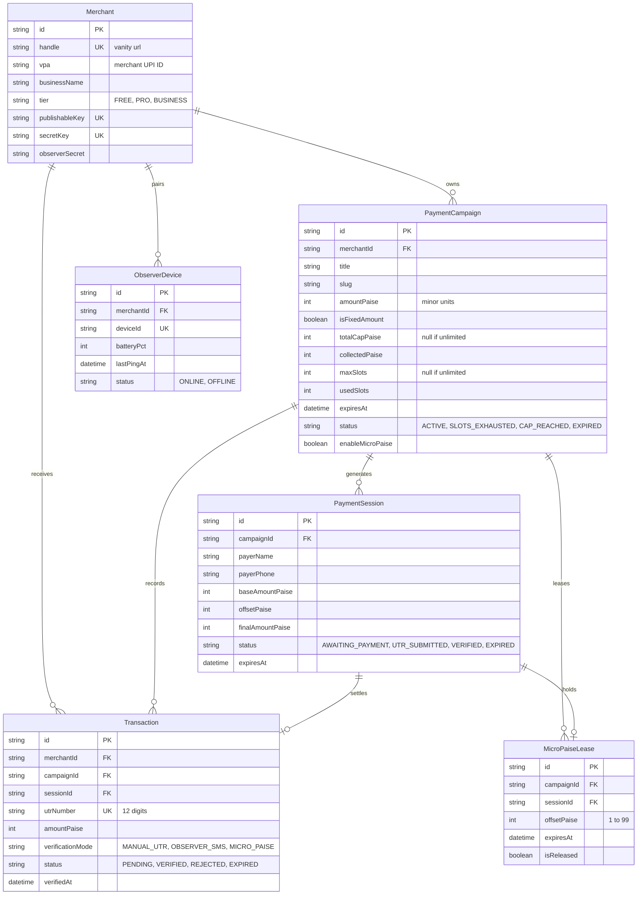

# QuickUPI Database Schema & Data Models

**Document Version:** 1.0.0  
**ORM:** Prisma 5.x  
**Storage Engine:** SQLite (Local Dev) / PostgreSQL (Production)  
**Last Updated:** October 2026  

---

## 1. Relational Entity Diagram



---

## 2. Complete Prisma Schema (`prisma/schema.prisma`)

```prisma
datasource db {
  provider = "sqlite" // In production: "postgresql"
  url      = env("DATABASE_URL")
}

generator client {
  provider = "prisma-client-js"
}

enum MerchantTier {
  FREE
  PRO
  BUSINESS
}

enum CampaignStatus {
  ACTIVE
  PAUSED
  SLOTS_EXHAUSTED
  CAP_REACHED
  EXPIRED
}

enum SessionStatus {
  AWAITING_PAYMENT
  UTR_SUBMITTED
  VERIFIED
  EXPIRED
  OVERSUBSCRIBED
}

enum TransactionStatus {
  PENDING
  VERIFIED
  REJECTED
  EXPIRED
  AMOUNT_MISMATCH
  OVERSUBSCRIBED_REFUND_DUE
}

enum VerificationMode {
  MANUAL_UTR
  OBSERVER_SMS
  OBSERVER_NOTIFICATION
  MICRO_PAISE_MATCH
}

enum DeviceStatus {
  ONLINE
  OFFLINE
}

model Merchant {
  id             String       @id @default(cuid())
  email          String       @unique
  passwordHash   String
  name           String
  businessName   String?
  handle         String       @unique // e.g. "arslan" -> quickupi.in/pay/arslan
  vpa            String       // e.g. "arslan@okhdfcbank"
  tier           MerchantTier @default(FREE)
  
  publishableKey String       @unique @default(cuid())
  secretKey      String       @unique @default(cuid())
  observerSecret String       @default(cuid())

  createdAt      DateTime     @default(now())
  updatedAt      DateTime     @updatedAt

  campaigns      PaymentCampaign[]
  transactions   Transaction[]
  observerDevices ObserverDevice[]

  @@index([handle])
  @@index([publishableKey])
}

model PaymentCampaign {
  id               String         @id @default(cuid())
  merchantId       String
  merchant         Merchant       @relation(fields: [merchantId], references: [id], onDelete: Cascade)

  title            String
  slug             String
  description      String?
  
  // Financial arithmetic strictly in integer paise (₹2,000.00 = 200000)
  amountPaise      Int
  isFixedAmount    Boolean        @default(true)
  
  // Hero limits
  totalCapPaise    Int?           // e.g. 5000000 (₹50,000 cap)
  collectedPaise   Int            @default(0)
  
  maxSlots         Int?           // e.g. 25 slots
  usedSlots        Int            @default(0)
  
  expiresAt        DateTime?      // dynamic timer expiry
  status           CampaignStatus @default(ACTIVE)
  enableMicroPaise Boolean        @default(false)

  createdAt        DateTime       @default(now())
  updatedAt        DateTime       @updatedAt

  sessions         PaymentSession[]
  transactions     Transaction[]
  microPaiseLeases MicroPaiseLease[]

  @@unique([merchantId, slug])
  @@index([merchantId, status])
}

model PaymentSession {
  id                  String        @id @default(cuid())
  campaignId          String
  campaign            PaymentCampaign @relation(fields: [campaignId], references: [id], onDelete: Cascade)

  payerName           String?
  payerEmail          String?
  payerPhone          String?
  customNote          String?

  baseAmountPaise     Int
  offsetPaise         Int           @default(0) // sub-rupee variation (e.g. 14 for ₹0.14)
  finalAmountPaise    Int

  status              SessionStatus @default(AWAITING_PAYMENT)
  submittedUtr        String?
  expiresAt           DateTime
  createdAt           DateTime      @default(now())
  updatedAt           DateTime      @updatedAt

  transaction         Transaction?
  lease               MicroPaiseLease?

  @@index([campaignId, status])
  @@index([finalAmountPaise, status])
}

model Transaction {
  id                 String             @id @default(cuid())
  merchantId         String
  merchant           Merchant           @relation(fields: [merchantId], references: [id], onDelete: Cascade)
  
  campaignId         String
  campaign           PaymentCampaign    @relation(fields: [campaignId], references: [id], onDelete: Cascade)

  sessionId          String?            @unique
  session            PaymentSession?    @relation(fields: [sessionId], references: [id], onDelete: SetNull)

  utrNumber          String?            @unique // 12-digit bank reference number
  amountPaise        Int
  
  verificationMode   VerificationMode   @default(MANUAL_UTR)
  status             TransactionStatus  @default(PENDING)
  
  rawBankAlertText   String?
  payerVpa           String?
  payerName          String?
  payerPhone         String?

  verifiedAt         DateTime?
  createdAt          DateTime           @default(now())
  updatedAt          DateTime           @updatedAt

  @@index([merchantId, status])
  @@index([campaignId, status])
  @@index([utrNumber])
}

model ObserverDevice {
  id             String       @id @default(cuid())
  merchantId     String
  merchant       Merchant     @relation(fields: [merchantId], references: [id], onDelete: Cascade)

  deviceName     String       // e.g. "Pixel 8 Pro (Primary SIM)"
  deviceId       String       @unique // hardware UUID
  deviceSecret   String       // HMAC key provisioned via pairing QR
  
  appVersion     String?
  batteryPct     Int?
  isCharging     Boolean      @default(false)
  
  lastPingAt     DateTime     @default(now())
  status         DeviceStatus @default(ONLINE)

  createdAt      DateTime     @default(now())
  updatedAt      DateTime     @updatedAt

  @@index([merchantId, status])
}

model MicroPaiseLease {
  id             String          @id @default(cuid())
  campaignId     String
  campaign       PaymentCampaign @relation(fields: [campaignId], references: [id], onDelete: Cascade)

  sessionId      String          @unique
  session        PaymentSession  @relation(fields: [sessionId], references: [id], onDelete: Cascade)

  offsetPaise    Int             // 1 to 99
  leasedAt       DateTime        @default(now())
  expiresAt      DateTime
  isReleased     Boolean         @default(false)

  @@index([campaignId, offsetPaise, isReleased])
}
```

---

## 3. Atomic Limit Concurrency Invariant

To guarantee that `usedSlots` never exceeds `maxSlots` and `collectedPaise` never exceeds `totalCapPaise`, all confirmations must execute the following state transition query:

```sql
UPDATE "PaymentCampaign"
SET 
  "usedSlots" = "usedSlots" + 1,
  "collectedPaise" = "collectedPaise" + $amountPaise,
  "status" = CASE 
    WHEN "maxSlots" IS NOT NULL AND ("usedSlots" + 1 >= "maxSlots") THEN 'SLOTS_EXHAUSTED'
    WHEN "totalCapPaise" IS NOT NULL AND ("collectedPaise" + $amountPaise >= "totalCapPaise") THEN 'CAP_REACHED'
    ELSE "status"
  END
WHERE "id" = $campaignId
  AND ("maxSlots" IS NULL OR "usedSlots" < "maxSlots")
  AND ("totalCapPaise" IS NULL OR "collectedPaise" + $amountPaise <= "totalCapPaise");
```

If the rows affected count is `0`, the atomic update failed, indicating the limit was simultaneously consumed by another payer.
