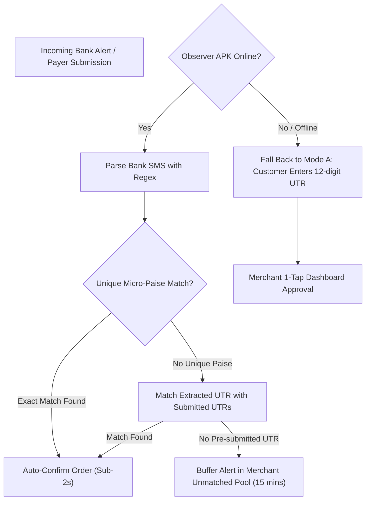

# QuickUPI Hybrid Verification Mesh Specification

**Document Version:** 1.0.0  
**Status:** Core Protocol Specification  
**Last Updated:** October 2026  

---

## 1. The Core Problem: Why the Verification Mesh is Necessary

In traditional payment gateways (Razorpay, Stripe), the gateway's bank sends server-to-server HTTP webhooks (`payment.captured`) directly to the gateway server because the gateway owns the acquiring escrow account.

In QuickUPI's **sovereign direct-to-bank model (0% fee, T+0)**:
* Payments move directly from the customer's bank account to the merchant's personal or business bank account via NPCI UPI rails.
* Retail Indian banks (HDFC, SBI, ICICI, etc.) do not expose open webhook APIs for regular retail accounts.
* Merely displaying a static QR code leads to the *"Screenshot Nightmare"*, where merchants must manually check their mobile phone, match screenshots on WhatsApp, and cross-reference bank statements.

QuickUPI replaces this with a **Tri-Channel Hybrid Verification Mesh**:

```
                                  ┌───────────────────────────┐
                                  │   Incoming UPI Transfer   │
                                  │   (Payer ➔ Merchant Bank) │
                                  └─────────────┬─────────────┘
                                                │
                 ┌──────────────────────────────┼──────────────────────────────┐
                 ▼                              ▼                              ▼
        ┌──────────────────┐           ┌──────────────────┐           ┌──────────────────┐
        │      MODE A      │           │      MODE B      │           │      MODE C      │
        │ Zero-Infra UTR   │           │ Android Observer │           │ Dynamic Micro-   │
        │ Logging          │           │ Push Node        │           │ Paise Matching   │
        ├──────────────────┤           ├──────────────────┤           ├──────────────────┤
        │ • Customer types │           │ • Companion APK  │           │ • ₹2000.12, .27  │
        │   12-digit UTR   │           │ • Intercepts SMS │           │ • Unique sub-    │
        │ • Instant sanity │           │ • HMAC-SHA256    │           │   rupee offset   │
        │   checks         │           │   signed webhook │ • Instant auto-  │
        │ • 1-tap merchant │           │ • Sub-second     │   correlation    │
        │   verification   │           │   auto-confirm   │ • No UTR wait    │
        └──────────────────┘           └──────────────────┘           └──────────────────┘
```

---

## 2. Mode A: Zero-Infra UTR Logging (100% Free / Default)

### 2.1 Workflow
1. The payer completes the payment in Google Pay, PhonePe, Paytm, or CRED.
2. The banking app displays the 12-digit UPI Reference Number / UTR (Unique Transaction Reference).
3. The payer inputs the 12-digit number on the QuickUPI checkout page.
4. QuickUPI performs instant client & server validation:
   * Regex format: `/^\d{12}$/` (exactly 12 numeric digits).
   * Uniqueness check: Confirms the UTR has not been used in any previous transaction in the database.
5. The transaction record is created with status `PENDING_VERIFICATION`.
6. The merchant's dashboard receives an audio chime and live visual entry with details:
   * Payer Name / Mobile / Note
   * Amount in INR
   * Entered UTR Number
   * 1-Tap Actions: `[Verify & Approve]` or `[Dispute / Decline]`
7. Upon merchant tap, status transitions to `VERIFIED`, and the campaign limit slot is decremented atomically.

---

## 3. Mode B: Automated Observer Node (Android Companion APK)

### 3.1 Overview
For merchants with higher volume (or Pro tier subscribers), manual approval can be eliminated entirely using the **QuickUPI Observer Companion App** (lightweight Android APK inspired by YouPI PG).

The merchant installs this app on their Android phone that houses the SIM card receiving bank alerts. The APK operates continuously as a low-battery foreground service.

### 3.2 Operating Channels
1. **SMS Receiver Channel:** Intercepts `android.provider.Telephony.SMS_RECEIVED` broadcasts.
2. **Notification Listener Channel:** Utilizes `android.service.notification.NotificationListenerService` to capture push notifications from banking apps (BHIM, PhonePe Business, Google Pay for Business, Paytm for Business, iMobile, HDFC MobileBanking).

### 3.3 Security Handshake & HMAC-SHA256 Signing
Every incoming alert pushed by the Observer APK to the QuickUPI server must be cryptographically signed to prevent spoofing:

```
Payload to Sign:
rawBody = '{"deviceId":"OBS-9823","rawText":"Cr Rs 2000.00 from UPI/429182736451...","timestamp":1729348200000}'
signature = HMAC_SHA256(secretKey, rawBody + "." + timestamp)
```

**HTTP Headers Sent by Observer:**
```http
POST /api/v1/observer/push HTTP/1.1
Host: quickupi.in
Content-Type: application/json
X-Observer-Device-Id: OBS_DEVICE_UUID_12345
X-Observer-Timestamp: 1729348200000
X-Observer-Signature: 8f4a7c... (64-character lowercase hex string)
```

**Server Verification Rules:**
1. Fetch device record by `X-Observer-Device-Id`.
2. Check `Math.abs(Date.now() - X-Observer-Timestamp) < 60000` (reject if timestamp is skewed by > 60 seconds).
3. Compute expected HMAC using stored `merchant.observerSecretKey`.
4. Use timing-safe comparison (`crypto.timingSafeEqual`) to prevent timing side-channel attacks.

### 3.4 Multi-Bank Regular Expression Parser Engine

When an alert passes HMAC authentication, the text is routed through deterministic regex parsers:

#### HDFC Bank
* **Sample SMS:** `Dear Customer, Rs 2,000.00 credited to a/c **1234 on 19-10-26 by UPI-ARSLAN-arslan@okhdfc-429182736451-payment. Bal Rs 45,210.00.`
* **Regex Pattern:**
  ```regex
  /(?:Rs\.?|INR)\s*([\d,]+\.?\d*)\s*credited to a\/c.*?(?:UPI[-/]|UTR[:\s]+|Ref[:\s]+).*?(\d{12})/i
  ```

#### State Bank of India (SBI)
* **Sample SMS:** `Your a/c no. XX1234 is credited by Rs.2,000.00 on 19Oct26 by UPI/CR/429182736451/Arslan. (Ref no 429182736451).`
* **Regex Pattern:**
  ```regex
  /credited\s*(?:by|with)?\s*(?:Rs\.?|INR)\s*([\d,]+\.?\d*).*?(?:UPI\/CR\/|Ref\s*no\s*)(\d{12})/i
  ```

#### ICICI Bank
* **Sample SMS:** `Dear Customer, your Acct XX123 is credited with INR 2,000.00 on 19-Oct-26 by UPI Ref no 429182736451. Available Balance is...`
* **Regex Pattern:**
  ```regex
  /(?:INR|Rs\.?)\s*([\d,]+\.?\d*)\s*on.*?by\s*UPI(?:\s*Ref\s*(?:no)?)?[:\s]*(\d{12})/i
  ```

#### Axis Bank
* **Sample SMS:** `Dear Customer, INR 2000.00 credited to Axis Bank A/c ...123 on 19-10-2026 18:30:12 by UPI/429182736451/Arslan.`
* **Regex Pattern:**
  ```regex
  /(?:INR|Rs\.?)\s*([\d,]+\.?\d*)\s*credited.*?UPI\/(\d{12})/i
  ```

#### Kotak Mahindra Bank
* **Sample SMS:** `Rs. 2000.00 credited to Kotak Bank A/c ...123 on 19-Oct-26. UPI Ref no 429182736451. Balance...`
* **Regex Pattern:**
  ```regex
  /(?:Rs\.?|INR)\s*([\d,]+\.?\d*)\s*credited.*?UPI\s*Ref(?:\s*no)?[:\s]*(\d{12})/i
  ```

#### Generic UPI Fallback Pattern
* If no bank-specific format matches:
  ```regex
  /(?:credited|received|deposited)\s*(?:by|with|of)?\s*(?:Rs\.?|INR)\s*([\d,]+\.?\d*).*?(\d{12})/i
  ```

---

## 4. Mode C: Dynamic Micro-Paise Disambiguation

### 4.1 Concept & Problem Solved
If an event sells tickets for exactly ₹2,000 and 10 users checkout simultaneously:
* All 10 transfers appear in the bank statement as `₹2,000.00`.
* If User 3 pays before submitting their UTR, an incoming Observer SMS of `₹2,000.00` cannot distinguish between User 1, User 2, or User 3 without the UTR.

### 4.2 The Sub-Rupee Lease Algorithm
Instead of forcing users into a serial queue (one-at-a-time), QuickUPI leases a **unique micro-paise offset** from a pool (`01` to `99` paise) for the duration of the checkout session (default: 5 minutes):

1. **Base Amount:** ₹2,000.00 (`200000` paise)
2. **Payer A Session:** Allocated offset `+12` paise ➔ **Requested: ₹2,000.12** (`200012` paise)
3. **Payer B Session:** Allocated offset `+27` paise ➔ **Requested: ₹2,000.27** (`200027` paise)
4. **Payer C Session:** Allocated offset `+35` paise ➔ **Requested: ₹2,000.35** (`200035` paise)

### 4.3 Deterministic Matching
* When bank SMS alerts: *"Cr Rs 2000.27 from UPI/429182736451"*:
  * The server extracts amount: `200027` paise.
  * System queries active leases: `WHERE amountPaise = 200027 AND status = 'AWAITING_PAYMENT'`.
  * Exactly **one** matching session (Payer B) is returned.
  * Payer B's order is immediately marked `VERIFIED`.
  * The `.27` paise offset is released back into the pool.
* **Payer experience:** Customer pays via GPay/PhonePe and sees *"Payment Confirmed!"* in 2 seconds without having to type a single character of UTR!

---

## 5. Mesh Failure Modes & Fallback Hierarchy


